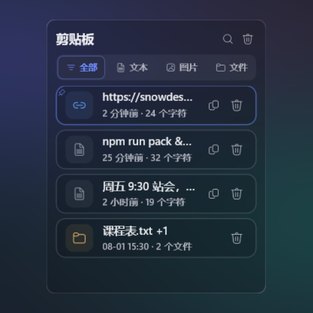

# 剪贴板 — SnowDesktop 组件

一个 [SnowDesktop](https://snowdesktop.com/) 桌面剪贴板历史板：自动记录文本、图片和文件名，支持筛选、置顶与写回文本和图片。

<p align="center"></p>

> 非官方组件。英文名「Clipboard」。

> **仓库与工坊版本可能不同步。** 本仓库 `main` 跟随最新开发/测试宿主（当前 1.1.1，需要带剪贴板订阅接口的 SnowDesktop）；Steam 创意工坊只发布与**正式版宿主**兼容的版本（当前 1.0.4）。正式版尚未集成订阅接口前，工坊不会更新——使用正式版的用户请从工坊安装，测试版用户可以按「安装 → 作为开发组件」从本仓库安装。

## 功能

- **文本自动记录**：在其它应用里复制后自动进入历史，链接与代码有独立图标。
- **搜索**：卡片内搜索框按关键词即时过滤当前分类（文本按全文匹配，图片和文件按标题匹配）。
- **预览与复制**：点击文本或图片条目打开预览。面板底部提供「保存并复制」「仅复制草稿」；复制按钮与右键菜单也可以把内容写回剪贴板，关闭面板即放弃未保存的草稿。可用的图片还可拖到接收位图或 PNG 附件的窗口。
- **编辑文字预览**：在多行文本框里编辑；「保存并复制」会用草稿替换历史原文（通常保留 ID、置顶与时间戳；若与另一条历史相同则合并到该条，以该条的 ID 和时间戳为准）并写回剪贴板，Ctrl+Enter 同效；「仅复制草稿」只写回、不改历史。关窗丢弃未保存草稿。支持 `view.textArea.largeValue` 的宿主可编辑现有 256 KiB 限额内的文本；超过 48 KiB 的编辑仅保留在本次会话。
- **文件记录**：显示文件展示名和数量。支持文件地址的宿主可以复制完整路径，多项各占一行。
- **去重**：宿主提供图片内容 ID 或文件引用时，相同内容会更新原条目并保留置顶。
- **图片优先识别**：剪贴板同时包含图片像素和 `CF_HDROP` 时优先按图片处理，不再把复制图片误记为文件。
- **分类筛选**：全部 / 文本 / 图片 / 文件四个标签页；右键菜单可进一步按链接、代码过滤。
- **置顶与删除**：置顶条目不会被历史容量淘汰；可单项删除或两步确认清空。
- **历史容量**：默认 20 条，可在组件设置里选择 10 / 20 / 30 / 50 / 100 / 150 / 200；置顶内容永不自动淘汰；存储预算占满时最旧的未置顶条目自动让位。
- **隐私保护**：识别 `Clipboard Viewer Ignore`、`ExcludeClipboardContentFromMonitorProcessing`、`CanIncludeInClipboardHistory=0` 和 `CanUploadToCloudClipboard=0`，命中时不读取具体内容。
- **中英双语**、磨砂 / 实色 / 透明三种外观，跟随系统深浅色。

## 限制

- 图片和文件条目在当前会话内可用。支持原始尺寸的宿主会按原图尺寸写回和拖出图片。后台最多保留最近 8 张不同图片的可用资源，缓存也会按容量淘汰旧图。后台图片仍可通过缩略图预览。
- 自动记录需要授予「在后台读取剪贴板内容」权限。右键标题可手动读取当前剪贴板。
- Windows 的隐私剪贴板标记是应用间的协作约定，不是系统级访问控制；不遵守约定的第三方程序仍可能读取剪贴板。
- 历史容量达到上限后，最旧的未置顶条目会被淘汰。

## 安装

### 从文件安装（推荐）

1. 到本仓库的 [Releases](../../releases) 下载最新的 `clipboard.snowwidget`。
2. SnowDesktop → **设置 → 组件 → 从文件安装…**，选择该文件。
3. 首次运行按提示确认剪贴板读取、写入权限。需要自动记录时，同时允许后台读取。

### 作为开发组件

把仓库内容（`widget.json`、`main.lua`、`modules/`、`tests/`、`preview.png`、`previews/`）放进：

```
<SnowDesktop 安装目录>\data\widgets\dev\clipboard\
```

开发版清单版本高于已安装版时，可在 **设置 → 组件 → 技术详情 → 安装到“已安装”** 把当前开发快照写入已安装来源，再按需启用或停用开发版。

## 权限

| 权限 | 用途 |
| --- | --- |
| `clipboard.read` | 用户点击后读取文本、图片或文件引用 |
| `clipboard.write` | 将文本或图片写回系统剪贴板 |
| `clipboard.observe`（可选） | 订阅剪贴板变更，自动记录文本、图片缩略图和文件展示名 |

## 兼容性

- 需要支持 `data.clipboard.changes` 的 SnowDesktop 1.0.17.0 或更新版本（API v2）。旧宿主请使用组件 1.0.4。
- 支持 `data.clipboard.changes.image` 的宿主可以写回近期后台图片。只有基础订阅能力的宿主可通过右键标题手动读取并写回当前图片。
- 图片去重需要宿主支持 `clipboard.imageIdentity`。
- 直接拖出和复制文件地址分别检测 `interaction.dragImage` 和 `clipboard.filePaths`；宿主提供原始尺寸时按原图尺寸写回。
- 无网络请求、无外部服务。
- 核心能力：即时绘制、滚动区域、右键菜单、剪贴板订阅、定时任务、本地化和组件存储。

## 开发

```powershell
snowwidget lint    .
snowwidget test    .      # 27 个用例：文本模型、缩略图解码、独立记录、刷新补全、存储
snowwidget preview . preview.png --columns 3 --rows 3 --canvas-size 512 --padding 32 --appearance glass-dark --locale zh-CN
snowwidget quality .
snowwidget pack    . clipboard.snowwidget
snowwidget validate clipboard.snowwidget
```

### 结构

```
main.lua                 组件生命周期、绘制、输入、宿主任务
modules/clipboard.lua    纯数据模型：历史、筛选、合并、持久化编码
modules/preview.lua      将 RGB 缩略图转为绘制数据
modules/storage.lua      原子存储事务
tests/                   snowwidget 单元测试
```

### 设计要点

- 后台记录由宿主 `clipboard.changes` 订阅驱动。手动刷新在可信手势中调用 `clipboard.read`。
- 收到图片或文件事件时追加历史；宿主提供内容 ID 或文件引用时更新对应条目，不重复追加。刷新任务携带当前监听条目 ID，补全对应记录。
- 历史文本使用 `entry.<timestamp>-<seq>` 存储键，插入与淘汰通过 `storage.transaction` 原子提交。

## License

[MIT](LICENSE) © Yskye
